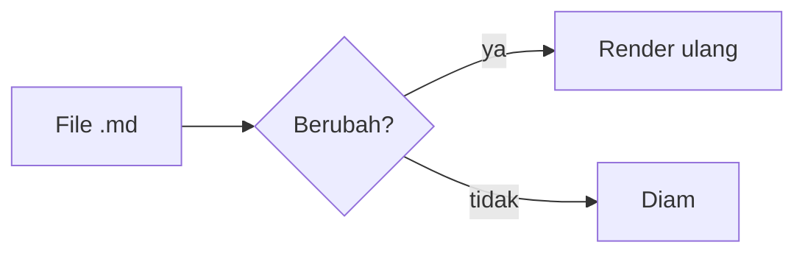

# MD Viewer Demo

Paragraf dengan **tebal**, *miring*, ~~coret~~, `inline code`, dan link ke [Tauri](https://tauri.app).
Link ke [dokumen lain](./other.md) dan ke [bagian tabel](#tabel).

## Daftar tugas

- [x] Render markdown
- [x] Syntax highlight
- [ ] Rilis v1

## Tabel

| Fitur | Status |
|-------|:------:|
| Mermaid | ✅ |
| KaTeX | ✅ |

## Kode

```ts
export function greet(name: string): string {
  return `Halo, ${name}!`; // komentar
}
```

```rust
fn main() {
    println!("hello {}", 42);
}
```

## Matematika

Inline $E = mc^2$ dan blok:

$$
\int_0^\infty e^{-x^2}\,dx = \frac{\sqrt{\pi}}{2}
$$

## Diagram



## Gambar relatif


> Kutipan dengan catatan kaki.[^1]

<script>alert('xss')</script>


[^1]: Ini catatan kaki.
